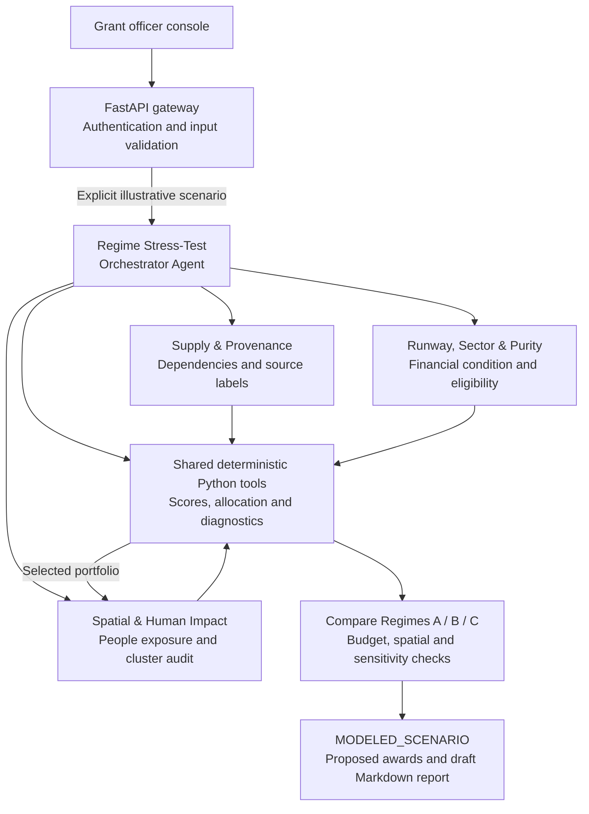
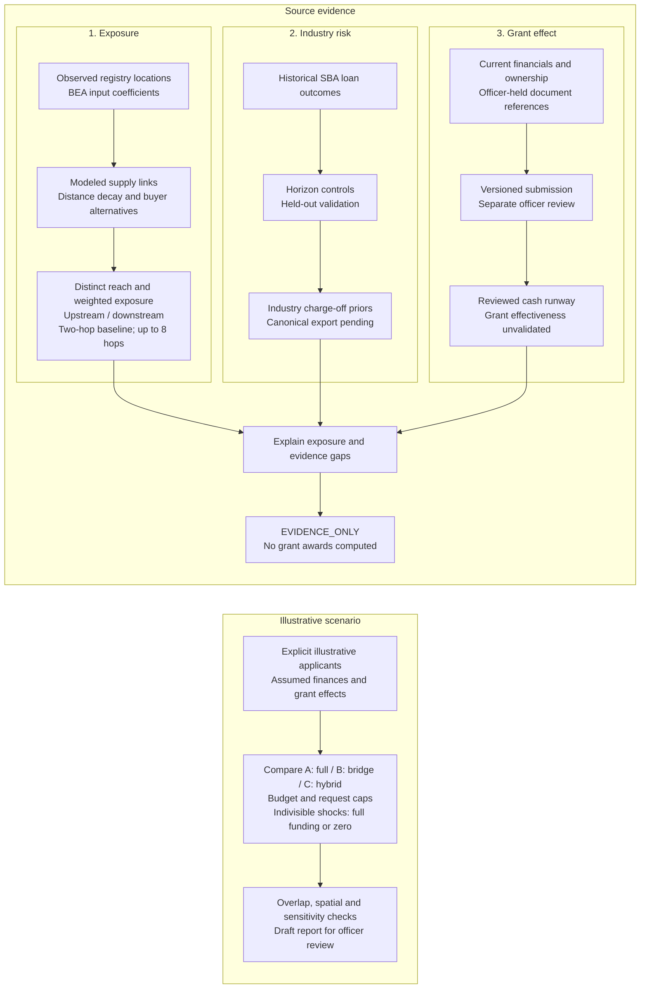

# Community Economic Resilience & Micro-Grants

A research prototype for deciding where small-business stabilization funding
could reduce connected harm to a commercial corridor. We separate **who is
exposed** through a modeled graph, **industry loan charge-off likelihood** from
SBA outcomes, and **what a grant could change** under explicit assumptions.

**Implemented:** a reproducible source audit, upstream/downstream traversal
through eight hops, BigQuery property-graph queries, SBA validation notebooks,
four cooperating agent modules, deterministic scoring, three funding regimes,
sensitivity checks, and structured audit reports.

**Exercised locally:** the 232-record registry review, 293-link supply model,
regression and integration tests, the deterministic four-agent benchmark, and the real-source
`EVIDENCE_ONLY` workflow. The benchmark runs all three funding regimes and reports
scenario checks individually. Its spatial radius check currently fails for one
fixture cluster; missing document reviews remain pending. Financials and beneficiary
totals are assumptions, not established grant effectiveness.

**Awaiting cloud validation:** the revised BigQuery SQL, canonical rate export
and new notebook diagnostics need an authenticated rerun. Live Google ADK/cloud
execution also needs verification. Earlier saved statistical results are
identified separately below.

Read the [reproducible review](data/TASK_2_3_REVIEW.md) and
[record-level audit](data/task_2_3_review.json) for current findings and source
corrections. Registry records are not necessarily distinct firms or physical
storefronts; possible duplicate filings remain visible for resolution.

## Agent architecture

The root orchestrator coordinates three specialist agents and calls shared Python
tools for numerical work. The console uses deterministic coordination. A separate
Google ADK entrypoint exposes the same specialist roles and tools for model-backed
execution; live ADK, Vertex AI and BigQuery MCP execution still require cloud
validation. The diagram shows the explicit scenario route; source evidence takes
its own route below and bypasses grant allocation.


The selected portfolio returns to the spatial agent for its cluster audit.

<details>
<summary>Editable Mermaid outline</summary>



</details>

The source route uses the reviewed local graph or an explicitly selected BigQuery
source. Intake revisions are stored in SQLite locally or a private Cloud Storage
bucket in the configured cloud deployment. Reviewing intake does not unlock
automatic awards: source records continue to return `EVIDENCE_ONLY`.

The [orchestrator](agents/regime_orchestrator_agent.py) assembles specialist findings,
portfolio calculations and draft reports. [Graph tools](tools/resilience_analysis.py),
[scoring and allocation](tools/scoring_engine.py),
[scenario checks](tools/compliance_reporter.py), and the
[evidence ledger](server/evidence.py) keep their calculations and review history
inspectable. The [ADK entrypoint](agent/agent.py) and
[MCP configuration](tools/mcp_bigquery_toolset.py) are separate from the console's
deterministic tool interface.

## Our approach

We keep three questions separate: **who is exposed**, **what historical industry
risk tells us**, and **what a grant might change**. A graph connection describes
modeled exposure; a historical charge-off prior describes a different quantity;
grant effectiveness requires its own evidence and assumptions.


<details>
<summary>Editable Mermaid outline</summary>



</details>

The illustrative scenario is a separate benchmark; it never supplies missing
financials or verified relationships to registry records. Allocation uses a
budgeted priority heuristic, with overlap and spatial diagnostics reported for
review. The sensitivity sweep describes sampled award stability, and the report
does not certify documents, establish jobs saved or approve awards.

## Task 2 — implemented graph work

| Capability | Implementation and evidence | Validation status |
|---|---|---|
| Three node types and three relationship types | `Business`, `Employer`, `Lender`; `Supplies`, `DrawsFootfall`, `BorrowedFrom` in [graph DDL and SQL](data/custom_bq_upload/schema_and_queries.sql) and the [connector](tools/bigquery_connector.py). One canonical graph: `a4i_econ.LocalEconomy`. | Revised cloud definitions implemented; execution pending. |
| Multi-hop impact and depth sensitivity | [Graph engine](tools/resilience_analysis.py) returns upstream/downstream reach for 1–8 hops, new/cumulative destinations, shortest explanation paths, and strongest weighted paths. GQL uses `ANY SHORTEST`; cycles and repeated paths cannot inflate unique reach. | Local traversal tested, including a six-hop chain; revised cloud GQL pending. |
| Keystone shortlist and hub comparison | Two-hop **5–25 destination** policy band, raw-reach baseline, weighted exposure, and GQL `NEXT ... FILTER` in [query B](data/custom_bq_upload/schema_and_queries.sql). Businesses outside the band remain eligible for a separate direct-relief/access review. | Local shortlist and hub-loss counterexample tested; cloud query pending. |
| Duplicate and branch audit | [Review builder](scripts/review_tasks_2_3.py) records IDs, legal names and addresses; [load notebook](notebooks/c3_01_load_explore.ipynb) stops on conflicting location keys. Same-name records are not silently merged or manually pinned. | Local review: nine same-name groups; four possible duplicate-filing groups remain unresolved. |
| Registry tenure and NAICS precision | Location start dates and coordinates come from the SF registry. Short/nonstandard NAICS values retain their precision and use sector fallback, rather than being guessed into groceries or restaurants. | Local source corrections checked; cloud loader updated. |
| Downstream debt and lender exposure | Address-checked loan edges and [query E](data/custom_bq_upload/schema_and_queries.sql) link exposed businesses to loan/lender evidence, retaining businesses without a match as **unknown debt**. | SQL implemented; revised cloud results pending. |
| Two-direction employer shock | [Query D](data/custom_bq_upload/schema_and_queries.sql) follows employer demand loss to storefronts and upstream suppliers. Footfall is aggregated before supplier joins to prevent multiplication. | SQL implemented; employer/footfall sources are not available locally. |

Two hops is the decision baseline; depths 3–8 test additional exposure. In the
current local model, seven roots gain new destinations at hop 3 and none at
hops 4–8. For Cumaica Coffee, cumulative reach is **27 → 51 → 55** at hops 1–3,
then stays at 55. This is a model-specific finding, not a universal impact limit.

## Task 3 — implemented analysis work

| Capability | Implementation and evidence | Validation status |
|---|---|---|
| Canonical failure priors and industry job proxies | [Validation notebook](notebooks/Challenge3.ipynb), section 8: horizon-controlled SBA outcomes, hierarchical beta-binomial shrinkage, uncertainty intervals, and computed loan-cohort median jobs. Exact-detail → sector → state fallback. Only `industry_failure_rates` is accepted. | Historical validation exists; the revised full export is pending and is not present locally. Industry jobs are not measured storefront employment. |
| Buyer-specific input alternatives | [Graph engine](tools/resilience_analysis.py) and enriched SQL count other same-input modeled suppliers connected to each buyer within 500m. A corridor-wide peer count is kept separate from buyer substitution. | Local counterexamples tested; these remain modeled options, not verified vendor substitutability. |
| Distance-decay sensitivity | Edge weights use `intensity × exp(-metres / 400) / (1 + buyer_input_alternatives)`. Path weights multiply; each endpoint contributes its strongest exposure once. Before/after ranks include all industries. | Local ranks generated; no named winner is forced. Revised cloud comparison pending. |
| Charge-off confusion matrix | Notebook section 10b evaluates a fixed 3% threshold on the SF holdout using rates fitted outside SF. | Implemented; new diagnostic has no saved result until rerun. |
| Industry variety and equity audit | Local cohort/shortlist counts, shares and concentration; notebook coverage and poverty/zero-vehicle comparisons using a labeled nearest-workplace-tract proxy. | Industry audit checked locally; revised ACS/footfall equity results pending. |
| Sole-proprietor selection-bias report | The saved SBA run reports **18,698 excluded individual/sole-proprietor loans**. Source rules keep missing SBA history separate from zero need. | Historical exclusion count documented; no claim that this validates unbanked or excluded businesses. |

The current source has **nine named industry groups plus one unspecified `72`
record**. The 20-record cascade shortlist covers only three groups: food services
are **70.0% of the shortlist versus 21.6% of the cohort**. This identifies the
supply model's sector bias; it does not justify a complete grant portfolio.
Retail, health care and other access-oriented cases need their own review.

## Other implemented modules

These capabilities already exist in the repository in addition to Tasks 2 and 3:

| Module | What is implemented | Scope |
|---|---|---|
| Four-agent coordination and selection | [Orchestrator](agents/regime_orchestrator_agent.py) coordinates [supply/provenance](agents/supply_provenance_agent.py), [runway/sector/purity](agents/runway_sector_purity_agent.py), and [spatial/human impact](agents/spatial_human_impact_agent.py). Named selectors, standalone agent packages, Google ADK factories and a [root entrypoint](agent/agent.py) are wired in code. | All four deterministic selectors and their source gates tested; live model-backed execution not verified in this review. |
| Five scoring dimensions | [Scoring engine](tools/scoring_engine.py): financial runway and marginal survival lift; sector volatility; people-helped/efficiency scores combining direct workers, network workers, commuters and residents; small-business ownership/size purity; upstream/root-supplier importance. Community-anchor and ACS equity multipliers are also implemented. | Scenario calculations; current applicant finances and service reach are not inferred from registry data. |
| Eligibility and provenance rules | Supplied ownership, headcount, location and storefront inputs; NAICS-81 scenario filters; modeled/verified tags; invoice-request flags; zero-cascade comparison. | Policy/model assumptions. A verification flag is not an inspected invoice or a statutory eligibility determination. |
| Funding regime comparison | Full-grant threshold (A), concave bridge (B), and tiered hybrid (C), with budget limits, indivisible-shock handling and alternate-routing fields. Regime C reserves an affordable community-anchor slot and then funds urgent flexible requests. Awards are capped at requests; indivisible shocks require full funding. | Priority-based scenario allocation. Despite the `optimize_portfolio_knapsack` name, this is not an exact knapsack solver or a guarantee that every cluster can reach critical mass. |
| Overlap, spatial and bottleneck diagnostics | Jaccard downstream overlap penalties, proximity/critical-mass checks, and unapplied-supplier alert dossiers. | Overlap is reported after allocation; the spatial audit checks counts and a straight-line 200m centroid radius proxy. It does not measure pedestrian routes. Legacy bottleneck alerts use fixture/industry assumptions, not source-verified supplier discovery. |
| Sensitivity analysis | Four policy-weight configurations plus a 51-point cascade/anchor sweep; reports intersections and sampled ranking intervals. | Sampled scenario checks, not a proof across all weights. Award changes are computed on the sampled grid; no exact crossover is asserted. |
| Audit reports and context tools | [Reporter](tools/compliance_reporter.py) evaluates ten scenario attack vectors and a five-step field checklist, then generates a Markdown determination-style report. [Context loader](ADK/adk_context_loader.py) indexes seven documents, equations, agent rubrics and defense sections, including the merged refactor guide. | Draft reports derive checks from current awards. Document-review statuses remain pending; no audit certificate or actual award approval is issued. |
| Source-evidence safeguards | Real-source agent records return `EVIDENCE_ONLY`; missing finances, ownership and invoices are not fabricated. The source loader never silently falls back to the illustrative benchmark. | Source-mode behavior and refusal to score incomplete source records tested. |
| Live traversal, comparison and MCP wiring | [Connector](tools/bigquery_connector.py) exposes named shortest paths, graph traversal, applicant comparison and funding entrypoints; [MCP toolsets](tools/mcp_bigquery_toolset.py) and [toolbox definitions](tools.yaml) wire Google-managed BigQuery access. | Integration tests cover live-query failure, eight-hop/timeout propagation and evidence gates. A failed cloud call returns no invented paths; explicit local mode identifies BFS results separately. Authenticated MCP/GQL calls remain unverified. |
| Runtime and deployment sources | [Server](server/app.py), [runtime deployment](scripts/deploy_agent_runtime.py), [deployment script](scripts/deploy.sh) and [Dockerfile](Dockerfile) provide the merged service/deployment entrypoints. See the [refactor and verification guide](ADK/docs/04_ADK_REFACTOR_AND_TEST_GUIDE.md). | The local gateway and browser workflow are covered by integration checks. Authenticated cloud deployment remains unverified. |

The [source-evidence rules](ADK/docs/04_SOURCE_EVIDENCE_AND_REVIEW.md) take priority
over numerical examples and policy assumptions in the earlier design documents.

## Five linked community problems

| Problem | Connected mechanism | Current evidence |
|---|---|---|
| Input disruption | Supplier loss → buyers → further buyers | Traversable in the local modeled supply graph. |
| Lost upstream orders | Storefront demand loss → its suppliers | Traversable in reverse; order losses are not measured. |
| Lost worker demand | Employer block → storefronts → upstream suppliers | Cloud source/query support implemented; no local footfall snapshot. |
| Debt pressure | Exposed business → matched loan → lender | Strict-match SQL implemented; historical borrowing does not establish current distress. |
| Essential-service access | Affected food/health/community services → residents | Industry exposure proxy; catchment and resident-reach evidence still needed. |

Graph depth and the number of social mechanisms are different. A four-hop path
does not by itself establish four independently measured community harms.

## Run the connected review console

```sh
python3 -m pip install -r server/requirements.txt
python3 -m uvicorn server.app:app --host 127.0.0.1 --port 8080 --no-proxy-headers
```

Open http://127.0.0.1:8080. The console defaults to the 232-record reviewed registry
cohort. Select the illustrative scenario explicitly to compare regimes, policy
weights and proposed awards. The queue, tool console and downloaded Markdown report
use the same backend calculations. No browser-side scores or preset agent answers
are used. The tool console is deterministic; it does not pretend to be a Gemini chat.
The optional Vite development shell proxies the same console at `/console/`.

Select a registry location to enter current financials, ownership, shock category
and document references. Save a pending revision, inspect the actual documents,
then record a separate review with a reviewer name and finding. Edits invalidate
previous verification. Version conflicts return HTTP 409. Local records are stored
in `var/evidence.sqlite3` (override with `EVIDENCE_DB_PATH`), excluded from Git and
container builds. The revision history is retained. References identify officer-held
documents; the console does not upload bank statements or invoices.

A reviewed intake calculates cash runway but does **not** establish a causal grant
effect or authorize funding. Source records remain `EVIDENCE_ONLY`; unknown debt,
missing vendor evidence, unresolved registry duplicates and missing model evidence
must be addressed independently. The model never fills those gaps with the fixture.

All `/api/` routes require `RELIEF_API_TOKEN` when configured. Without a token, only
direct loopback connections are accepted; forwarded headers cannot grant access.
Enter the token in the console’s access panel (kept only in tab memory). API clients
send `Authorization: Bearer <token>`. Cloud Run requires both the configured token
and a private service; missing secrets fail closed. This is shared officer access,
not per-user identity management or separation of duties.

For deployment, configure `PROJECT_ID`, `SERVICE_ACCOUNT`, `API_TOKEN_SECRET` and
`EVIDENCE_GCS_BUCKET`, then run `bash scripts/deploy.sh`. The account needs access to
the named secret and private evidence bucket, plus only the BigQuery/Vertex access
used by the deployment. Provision these resources and permissions separately. Use
a private, versioned bucket with suitable retention controls. Cloud evidence uses
atomic [generation preconditions](https://cloud.google.com/storage/docs/request-preconditions)
to reject concurrent updates. Local SQLite is never used as durable Cloud Run
storage. The deployment script preserves tracked files and does not grant IAM
roles or auto-select an unrelated remote agent. Set `AGENT_RUNTIME_RESOURCE`
explicitly to use a remote runtime; its failure returns HTTP 502 without silently
switching execution backends. No cloud deployment is performed by the test suite.

## Verification

```sh
python3 -m pip install -r requirements-dev.txt
python3 -m unittest discover -s tests -v
python3 -m playwright install chromium
python3 tests/browser_smoke.py
```

The browser smoke test launches a temporary local gateway and checks authentication,
source paths, saved intake and review, scenario allocation, report download, mobile
layout, safe text rendering, and backend failure handling. It uses a temporary
private database. `CHROME_EXECUTABLE` can select an existing Chromium executable.
The GitHub Actions workflow installs dependencies and runs these checks, both agent
modes, JavaScript syntax validation, and shell syntax validation. ADK startup checks
run with an offline diagnostic model; they do not establish Gemini effectiveness.

After publishing the revised SQL/notebooks in the authenticated environment, run:

```sh
python3 scripts/cloud_smoke.py --project YOUR_PROJECT_ID
```

This opt-in check reads the existing cloud graph and source tables, compares two-hop
GQL and table traversal counts, checks named paths, and saves a result in
`var/cloud-smoke.json`. It neither installs graph DDL nor proves MCP/ADK execution.
An authenticated cloud result is still required before claiming cloud validation.

## Reproduce locally

No third-party Python dependency or cloud credential is needed for the source review:

```sh
python3 scripts/review_tasks_2_3.py
python3 -m unittest discover -s tests -v
python3 run_adk_test.py --mode local_csv
```

Run the assumed-input benchmark separately to exercise all four agent modules,
the three funding regimes, sensitivity analysis and audit-report generation:

```sh
python3 run_adk_test.py --mode canonical
python3 run_adk_test.py --list-agents
python3 run_adk_test.py --agent Supply_Provenance_Agent --mode local_csv
```

The local tests cover long-chain/reverse traversal, cycles, convergent paths,
strongest-versus-shortest paths, buyer alternatives, decay, invalid graph inputs,
the keystone band, NAICS precision, prior fallback, missing financial evidence,
all four agent selectors, connector timeouts, business-ID/name lookup, ambiguous
branches, scenario-ID separation and failure handling.
With `requirements.txt` installed, startup checks also load the real ADK
entrypoint and run a mock-model chat through the actual ADK runner. These checks
catch import and tool-registration failures; they do not validate cloud credentials
or replace a smoke test against the deployed Gemini/BigQuery environment.

The generated Markdown review and JSON audit include source coordinates, both
traversal directions, depth through eight hops, industry concentration and missing
evidence. Agent tools return the paths explaining each business's exposure.

The local reviewed supply model uses the pinned BEA coefficients, a **0.015**
coefficient floor, **500m** maximum distance, **five** suppliers per buyer and
**400m** exponential decay. These are declared modeling choices. The report also
rebuilds the starter's **0.005 / 1200m** variant for sensitivity; the two graphs'
counts must never be combined. Neither contains observed vendor contracts.

Registry snapshot: [public source](https://data.sf.gov/resource/g8m3-pdis.json),
as of 2026-10-20. [Activity groups](https://sftreasurer.org/business-activities-naics-codes)
follow the SF Treasurer's page. Source hashes and every changed NAICS/year value
are in the audit. The inherited cohort is not a fresh citywide sample.

## Reproduce in the authenticated BigQuery environment

1. Run [the load notebook](notebooks/c3_01_load_explore.ipynb) from this checkout.
   Review duplicate IDs and both addresses before resolving any collision.
   It now retains `location_start_date` and distinct same-name locations.
2. Run [the validation notebook](notebooks/Challenge3.ipynb). It publishes the
   canonical `industry_failure_rates`, exports its CSV, applies strict address
   checks, and adds depth, weighted exposure, industry variety, a held-out
   confusion matrix and an equity audit with a labeled workplace-tract proxy.
   Revised cells have no saved output until rerun. Earlier saved model validation
   outputs are historical evidence, not a fresh execution of the revised pipeline.
3. Run [the reviewed SQL](data/custom_bq_upload/schema_and_queries.sql) after
   those source tables exist. It preserves base tables and creates reviewed
   tables plus **one canonical graph, `a4i_econ.LocalEconomy`**. Duplicate keys,
   rate horizons and source metadata are checked before traversal. No loan or
   prior is synthesized through an `UNNEST` list.
4. Copy the notebook's full `data/industry_failure_rates.csv` into this checkout
   and run `python3 scripts/review_tasks_2_3.py --rates data/industry_failure_rates.csv`.
   Never reconstruct the full table from the few displayed notebook rows.

No cloud migration or paid reservation was executed during this local review.
The public cloud snapshot requires credentials unavailable in this environment.
The SQL and revised cloud notebook cells require execution in the authenticated
project before their new results can be cited.

## What remains before a real deployment or grant decision

- Execute the revised SQL/notebook cells in the authenticated project and retain
  their outputs, including the full canonical rate export, confusion matrix,
  equity coverage and actual GQL/table-traversal agreement.
- Resolve the four possible duplicate-filing groups against source records;
  the review deliberately reports registry IDs rather than confirmed unique firms.
- Supply current applicant cash, operating burn, debt payments, ownership,
  eligibility and vendor evidence. The $8,000 debt-bridge function is implemented,
  but its causal effectiveness is assumed and missing debt stays unknown.
- Validate live Google ADK/Vertex AI execution, a consumed Google-managed MCP
  integration, and cloud deployment. Their operational completion is not verified
  by this checkout or the deterministic benchmark.

## Evidence for failure likelihood

The [validation notebook](notebooks/Challenge3.ipynb) implements loan-term,
approval-year, age and franchise controls; training outside SF with an SF
holdout; cross-fitted industry priors; statewide five-fold cross-validation;
paired bootstrap AUC intervals; industry-clustered odds ratios; calibration
checks; and 24/36/48/60-month horizon sensitivity. These methods are part of the
implemented validation work, alongside the new diagnostics listed under Task 3.

The saved notebook analyzed 58,647 eligible California SBA 7(a) loans with a
48-month horizon (1,570 charge-offs), holding out 1,490 SF loans with 34 failures.
Loan terms alone had AUC **0.700**; adding graph structure gave **0.695**, change
**−0.005** with interval **−0.018 to +0.007**. No predictive gain is established.
The underlying SBA population excluded 18,698 individual/sole-proprietor loans;
its results cannot establish outcomes for excluded or unbanked businesses.
Industry history also had an interval spanning zero for its incremental AUC.
Across 47 industries, hub reach versus charge-off risk gave **rho −0.14, p=0.33**:
no positive association is established. This does not prove the true effect is zero.

Use graph structure for modeled consequence and SBA history as an industry
charge-off prior. Charge-off is not a storefront closure. SBA industry median
jobs are loan-cohort proxies, not measured employment at each business. Historical
charge-off does not demonstrate current insolvency. Current cash, burn, debt,
ownership, invoices and service catchments need applicant evidence.

## Agent behavior

`analyze_corridor_impact(business_id, max_hops=1..8, direction='downstream'|'upstream')`
returns evidence paths, unique reach and industry exposure. `review_industry_variety()`
compares the cohort and cascade shortlist. Source-based records return
`EVIDENCE_ONLY` from the orchestrator until financial/eligibility evidence exists.
The named 11-applicant benchmark remains available explicitly as an illustrative
scenario; it is never a silent fallback for real data.

Call `find_corridor_businesses("Sour Flour")` before tracing: the registry ID is
`1088753-08-161`; the illustrative `cm_01` is a separate scenario ID. A unique
exact business/legal name is also accepted. Unknown, ambiguous, partial and
scenario identifiers return structured statuses and candidate locations; only
`status == "OK"` contains a completed traversal. Same-name branches require
selecting a registry ID using its address.
